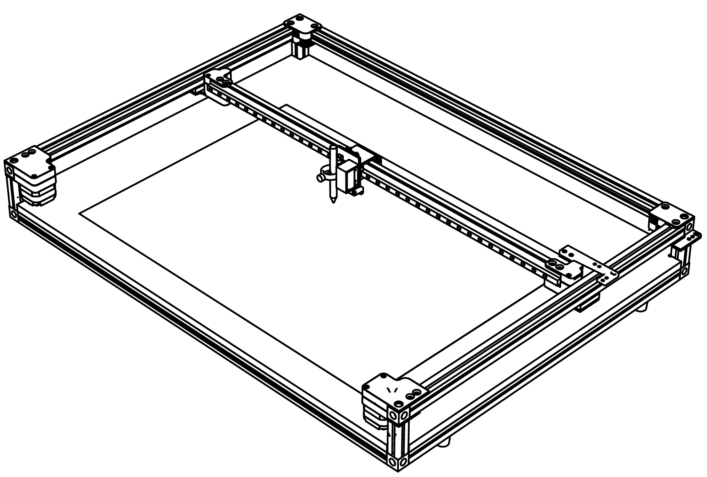

# Plotting area and paper

## How big can you go?

The terraPen plots a full **A2** area — **594 × 420 mm**. You can work anywhere within
that, not just in the centre.

!!! danger "Oversized artwork is not rejected — it crashes the machine"
    Nothing checks whether a job fits before it runs. Send an A1 drawing to an A2
    machine and the terraPen will start plotting it, drive into the end of its travel,
    and keep pushing.

    There are no soft or hard limits to catch this — see
    [there is nothing to stop you](movingThePenCarriage.md#there-is-nothing-to-stop-you).
    **Checking the artwork fits is your job, not the machine's.**

[terraForge](terraForge.md) is the best protection here: it shows your artwork on a
representation of the bed, so anything hanging over the edge is visible before you
send it. Make sure your machine profile is set to the real bed size of 594 × 420 mm,
or the picture it shows you will be wrong.

On terraPens shipped from autumn 2026, the bed has a grid printed on it, and the
machine's zero is the grid's origin — see [the bed grid and zero](bedGrid.md).

## Mounting your paper

- Place the paper square to the machine, with its edges parallel to the X axis.
- Hold it down with the supplied corner tabs, with tape, or — on a magnetic bed —
  with magnets.
- Get it as flat as possible. Any lift or ripple shows up in the drawing, and 
warped paper can catch the pen.

### Magnets on a magnetic bed

terraPens shipped from autumn 2026 have a metal baseboard, so paper can be held down
with magnets. Magnets are quick to place and move, but they stand proud of the paper,
which means the pen can hit them.

!!! warning "A magnet the pen catches can move the paper"
    The carriage does not stop for a magnet. If the pen or the toolhead catches one,
    it pushes the magnet off the sheet — and with it gone, the paper is free to shift
    under the rest of the plot. Everything drawn after that lands out of place.

To keep the magnets out of the way:

- **Leave a margin in your artwork.** Keep the drawing clear of the edges of the
  sheet, wide enough for the magnets to sit outside it.
- **Put the magnets in that margin**, clear of anywhere the pen goes — including the
  pen-up moves between strokes, where the nib passes only a few millimetres above
  the paper.
- **Check before you plot.** Jog the carriage around your artwork's bounding box with
  the pen up, as in the tip below, and watch that it clears every magnet.

## If the paper buckles mid-plot

A page taking on a lot of ink will cockle (wrinkle) and lift. Humidity can make this worse, and
paper varies a lot from brand to brand — different papers react differently, and a lot
of that is outside terraPen's control. If you are testing a new stock, a heavier weight
is often less prone to buckling and is worth trying.

It is tempting to reach in and tape it back down while the plot runs.

!!! warning "Do not re-tape a plot in progress"
    Re-fixing the paper part way through **shifts it relative to the drawing already on
    it**. The machine has no idea you moved anything and carries on from where it
    thinks it is, so the rest of the plot lands misaligned — usually worse than the
    buckle you were trying to fix.

Leave it be. The pen generally pushes a buckle back down as it passes over it.

The real fix is for next time: if a piece of work buckles enough to catch the pen, give
it **more Z lift** on the next run — see
[why 5 mm, and when you need more](1stPlot.md#3-fit-the-pen-and-set-its-height). Wet
media and dense hatching are the usual culprits.

!!! tip "Check your extents before you draw"
    Before plotting on good paper, jog the carriage — with the pen up — to each corner
    of your artwork's bounding box. This confirms the drawing fits on the stock and
    that nothing fouls the corner tabs or magnets.

    [terraForge](terraForge.md) shows your artwork positioned on a representation of
    the bed before you send it, which makes this much easier.
