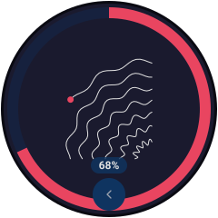

<!--- cSpell:ignore terraDial Elecrow CrowPanel Waveshare terraPixel Spirograph spirograph -->
# terraDial

terraDial is a small round control panel for the terraPen, with a touchscreen and a
rotary knob. It connects to the plotter over Wi-Fi, so you can home, jog, set the pen
and run plots from the bench without a laptop or phone.

{ width="240" }

*The home screen. The screens on this page are illustrations, not photographs.*

!!! danger "Do not run terraDial and terraForge at the same time"
    Having terraDial and [terraForge](terraForge.md) connected to the plotter
    together can **crash a plot part way through**, and you lose the sheet. Use one
    or the other:

    1. Make and upload your file in **terraForge**.
    2. **Disconnect terraForge.**
    3. Use **terraDial** to home, set the pen and run the plot.

    The same goes for the [web UI](terraPenWebUI.md): have one thing connected while
    a plot runs. This is the same limitation as
    [reconnecting to a running plot](startingAplot.md#decide-whether-you-are-staying).
    An update that may fix it is being tested — this page will say when it is safe.

## What it does

- **Home** X and Y, after asking you to confirm the bed is clear
- **Jog** X, Y and Z with the knob, in steps of 0.1, 1, 10 or 100 mm, and set zero on
  each axis
- **Pen** up and down
- **Jobs** — run G-code files from the plotter's SD card
- **Job progress** — elapsed time, an estimate of the time left, and the drawing
  appearing on the dial as the plotter draws it, with pause and stop
- **Photo** — lifts the pen, homes, and moves the gantry out of the way so you can
  photograph the finished plot
- **E-Stop** and alarm clear
- **Spirograph** — design a spirograph pattern on the dial and plot it

## What you need

terraDial runs on either of two off-the-shelf boards:

| Board | Notes |
|---|---|
| **Elecrow CrowPanel 1.28" Rotary** | The original. 240 × 240 screen, with an LED ring that shows the machine's state across the room. |
| **Waveshare ESP32-S3 Knob 1.8"** | Larger 360 × 360 screen, haptic clicks and a battery. The knob does not click, so tap the screen instead. The installer does not offer this board yet — for now its firmware has to be built from the [source](https://github.com/theworkisthework/terraDial#building). |

You also need a USB **data** cable (not a charge-only one) to install the firmware.
Files for a 3D-printed case and frame mount are in the
[terraDial repository](https://github.com/theworkisthework/terraDial).

## Setting it up

### 1. Install the firmware

Plug the board into your computer and open the
[terraDial installer](https://theworkisthework.github.io/terraDial/) in **Chrome or
Edge** on a desktop computer. Click **Connect and install**.

!!! note "Chrome or Edge only"
    The installer uses Web Serial, which Safari, Firefox and mobile browsers do not
    have.

### 2. Join your Wi-Fi

The first time it starts, terraDial is not connected to anything. Go to
**Settings → Wi-Fi**, tap the network name to scan, pick your network and type the
password.

Put it on the same network as your terraPen — see
[Connect to your own Wi-Fi](connectToPersonalNetwork.md).

### 3. Point it at the plotter

Go to **Settings → Machine** and enter the plotter's address: `terrapen.local`, or its
IP address if that does not work.

## Using it

The knob does most of the work; touch works everywhere too.

| Do this | To |
|---|---|
| **Turn** the knob | Move round the menu, or jog the selected axis |
| **Click** | Open the highlighted item, or confirm |
| **Long press** | Go back |
| **Tap the centre** | Open the running job, the current alarm, or E-Stop if the machine is moving |

The home screen is a ring of eight items, in the order a session usually goes:
**Home XY, Jog, Pen, Jobs, Photo, E-Stop, Lights, Settings.** E-Stop is always red, so
you can find it quickly.

### Running a plot

1. Upload your file with [terraForge](terraForge.md), then **disconnect terraForge**.
2. On the dial, **Home XY**.
3. Use **Jog** and **Pen** to [set the pen height](1stPlot.md#3-fit-the-pen-and-set-its-height).
4. Open **Jobs**, pick your file and confirm.

{ width="240" }

Tap the screen during a plot to bring up **pause** and **stop**. As with any plot,
[pause before you stop](startingAplot.md#stopping-a-plot-pause-first).

### E-Stop

E-Stop holds the machine and resets the controller. It acts the moment you press it,
and tells you what happened:

| Message | Meaning |
|---|---|
| **STOPPED** | The stop reached the plotter |
| **NOT SENT** | terraDial had no connection to the plotter. **Stop it by hand** with the power switch at the rear right. |

After an E-Stop the machine is in alarm, so clear it and home again, as
[after an abort](startingAplot.md#after-an-abort).

## Power

terraDial runs from USB, so a USB battery pack works too. Some battery packs switch
off when the current drawn is low, and terraDial draws very little while its screen
is asleep, so a pack might switch off during a long plot. Use a pack with a
low-current mode, or turn sleep off in **Settings → Display**.

## Updating

Go to **Settings → About → Check for updates**. terraDial will not update while the
plotter is busy, so you cannot interrupt a plot by accident. If an update fails part
way through, the dial carries on with the version it had.

The version it is running is shown at the top of the About screen — include it if you
report a problem on [Discord](https://discord.gg/fEXrmUm5nR).
